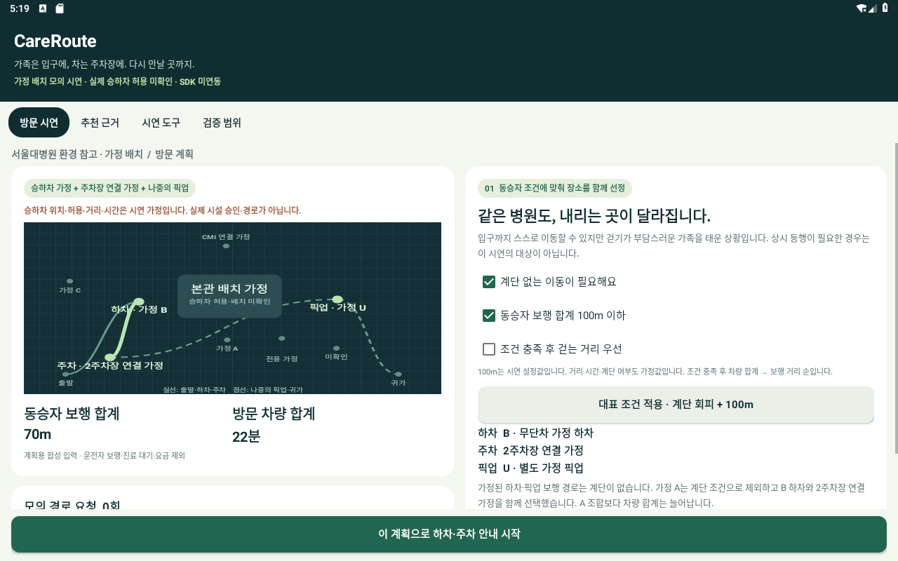

# CareRoute · 1차용 개발 시연 1.0.2

동승자의 보행 조건에 맞는 하차 지점과 연결 가능한 주차장을 함께 고르고, 하차 후 주차 안내와 나중 픽업까지 이어 쓰는 차량용 앱의 네이티브 Android 시연입니다.

**이번 배치는 서울대병원 환경을 참고한 개발용 가정입니다. 승하차 위치·허용·거리·차량 시간·주차장 연결은 미검증이며 실제 도로 안내가 아닙니다. 실제 Pleos SDK 호출은 0회입니다.**

- [현재 release APK](apk/CareRoute_CareRoute_release.apk): 1.0.2-demo / versionCode 102 / Android 9 이상.
- [현재 90초 시연 영상](demo/CareRoute_FirstRound_Demo_90s_1.0.2.mp4): APK 1.0.2 실행 화면 캡처 편집본. [영상 구성·범위](demo/README.md).
- [가정 배치와 실제 조사 근거](docs/ASSUMED_CAMPUS_KO.md)
- [실행 순서](JUDGE_START_KO.md)
- [이번 버전 검증 기록](docs/release-102/README.md)
- [제출 자료 전체 대조](docs/release-102/submission-audit.md)
- [이전 1.0.1 영상](demo/CareRoute_FirstRound_Demo_90s_20261029.mp4): 가상 한빛병원 화면 캡처 편집본. 이번 배치의 영상이 아닙니다.
- [이전 1.0.1 APK](apk/archive/1.0.1/CareRoute_CareRoute_release.apk)

## 실행

설치 후 앱 목록의 CareRoute · 모의 시연을 엽니다. 로그인·네트워크·위치·차량 권한과 별도 설정이 필요하지 않습니다. 기존 1.0.1 위에 같은 서명으로 업데이트할 수 있으며 이전 가상 시설의 저장 계획은 초기화합니다.

1. 기본 가정 A/CMI/A의 합성 180m·16분을 확인합니다.
2. ‘대표 조건 적용 · 계단 회피 + 100m’를 누르면 B 하차 → 2주차장 연결 → U 픽업, 70m·22분으로 바뀝니다. 차량 합계는 늘어납니다.
3. 모의 안내를 시작하고 B 도착을 재현하면 요청 #1을 유지한 채 주차 단계로 이어집니다.
4. 주차 후 연락만 받아서는 새 요청이 없습니다. 운전자가 픽업을 선택할 때 #2, 실제 탑승 확인 후 귀가를 선택할 때 #3입니다.
5. 시연 도구에서 가정 허용을 끄면 미확인 지점을 추천하지 않습니다.

숫자는 설명용 합성값입니다. 보행은 동승자의 하차·픽업 합계, 차량은 출발·하차·주차·나중 픽업·귀가 합계입니다. 운전자 보행·주차 대기·요금은 제외합니다. 실제 편익과 최적 경로를 입증한 값이 아닙니다.

## 개발·검증

JDK17 / Gradle8.10.2 / AGP8.8.2 / Android SDK35 / Build Tools35.0.0. 핵심 검사는 `./scripts/test-core.sh`, Gradle debug 빌드는 `./gradlew :app:assembleDebug`입니다. 직접 빌드 스크립트는 `scripts/build-sdk.sh`이며 Android SDK 도구를 사용합니다. Pleos SDK 연동 빌드를 뜻하지 않습니다.

release 재빌드에는 저장소 밖의 개인 서명키와 환경 변수가 필요합니다. 키·암호는 포함하지 않습니다. APK 해시는 `apk/SHA256SUMS.txt`에 있습니다. 새 버전의 검증 결과와 제한은 `docs/release-102/README.md`를 확인하십시오.

기획서 안내와 현재 영상은 APK 1.0.2의 가정 배치·조합·모의 흐름에 맞췄습니다. 영상은 연속 조작 녹화가 아니라 검증된 APK 실행 캡처 10개 장면에 설명을 붙인 편집본입니다. 신청정보·동의·서명과 실제 접수는 별도로 마쳐야 합니다. 기존 1.0.1 검증 기록은 역사 자료입니다.
