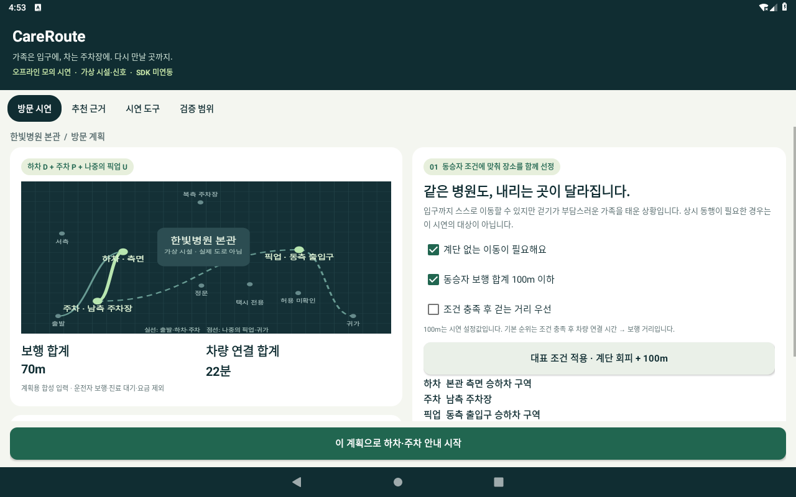

# CareRoute 1차 심사용 Android 시연

걷기가 부담스러운 동승자의 조건에 맞는 하차 지점과 연결 가능한 주차장을 함께 추천하고, 하차 후 주차 안내와 나중 픽업까지 이어주는 차량용 앱입니다.

## 먼저 볼 자료

- [90초 시연 영상](demo/CareRoute_FirstRound_Demo_90s_20261029.mp4): APK 1.0.1 실행 화면을 캡처해 편집한 자막형 영상. 연속 녹화·실차 영상은 아닙니다.
- [release APK 다운로드](apk/CareRoute_CareRoute_release.apk): 1.0.1-demo / versionCode 101 / Android 9 이상.
- [심사자 실행 안내](JUDGE_START_KO.md): 실제 버튼명과 기대 결과.
- [구현 및 검증 기록](docs/SUBMISSION_RELEASE_KO.md): 합성 데이터·실제 SDK 미연동 범위와 로그.

## 핵심 시연

1. 기본 계획의 정문 하차·북측 주차·정문 픽업과 180m / 16분을 확인합니다.
2. 대표 조건인 계단 회피 + 100m를 적용하면 측면 하차·남측 주차·동측 픽업과 70m / 22분으로 변경됩니다. 차량 시간은 늘어납니다.
3. 안내 시작 후 모의 계산 완료·안내 시작·측면 도착을 진행합니다. 하차 후 주차 요청 #1을 유지합니다.
4. 주차장 도착·가족 연락 후에도 요청 1회. 운전자가 픽업을 시작할 때 #2입니다.
5. 픽업 도착 후 운전자가 실제 탑승을 확인하고 귀가를 선택하면 #3입니다.

화면 아래 시연 조작은 실제 도착·전화·차량 신호가 아닌 심사용 입력입니다. 계획 시작 버튼은 하단에 고정되어 있습니다.

## 실행 환경

Android 9(API28) 이상에서 설치 후 앱 목록의 CareRoute · 모의 시연을 엽니다. 로그인·네트워크·위치 권한·별도 설정이 필요하지 않습니다. 기존 데이터가 있으면 시연 도구의 전체 초기화로 시작합니다. 재실행 시 저장 계획을 복원하고 정차 확인·명시적 재개를 요구합니다.

확인 환경: AOSP Android9 x86 에뮬레이터 1280×800 / 160dpi. 핵심 로직 36개(웹 기준 2,048개 입력 비교 포함), 화면·포인터·회전 89개, 프로세스 종료 후 복원 9개 확인 통과. 검사 횟수는 사용자 수가 아닙니다. 스크롤 이동은 프로그램으로 수행했습니다.

## 구현 경계

가상 한빛병원 한 곳의 합성 후보를 사용하는 Java 네이티브 오프라인 시연입니다. 실제 Pleos SDK 호출은 0회입니다. 실제 시설 허용 위치·차량 사용성·사용자 편익을 검증하지 않았습니다. 실제 SDK 연결 계획은 개발 문서에 따로 기술합니다.

## 빌드

JDK17 / Gradle8.10.2 / AGP8.8.2 / SDK35 / Build Tools35.0.0. 핵심 검사는 `./scripts/test-core.sh`로 실행합니다. Gradle 재빌드는 `./gradlew :app:assembleDebug`를 사용합니다. 배포 APK 1.0.1은 공식 SDK 직접 빌드본이며 APK 해시는 apk/SHA256SUMS.txt에 있습니다. release 재빌드에는 저장소 밖의 본인 서명키와 환경 변수가 필요합니다. scripts/build-sdk.sh 및 app/build.gradle을 참고하십시오. 서명키와 암호는 포함하지 않습니다.
